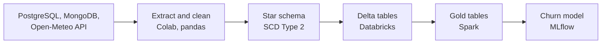
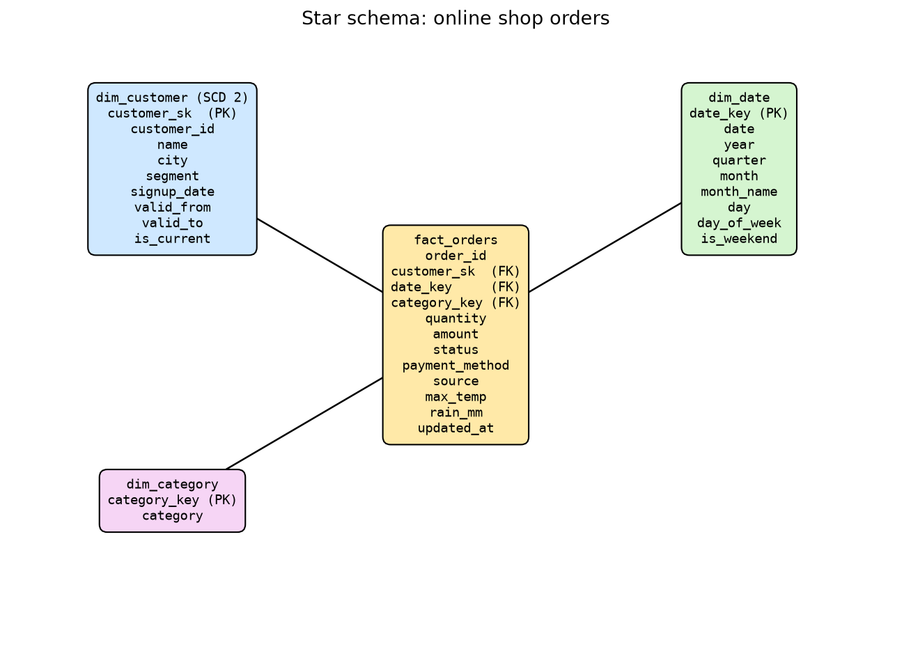
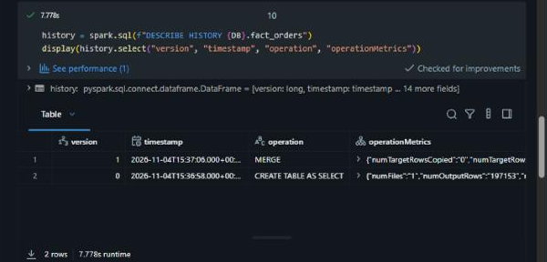
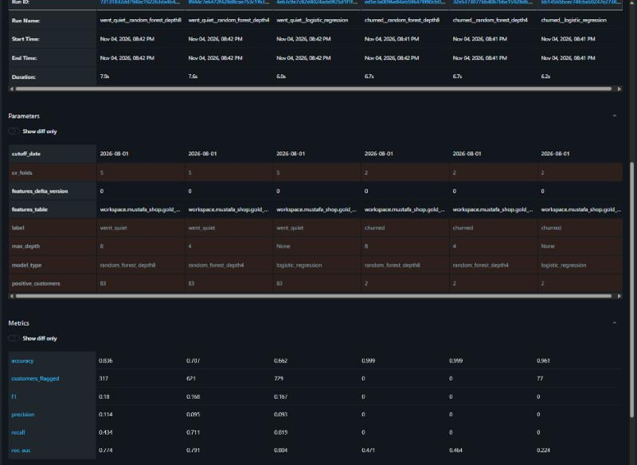
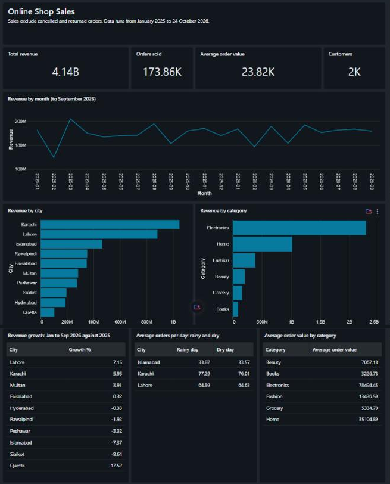

# Online Shop Data Pipeline

An end-to-end ETL pipeline for an online shop in Pakistan: from PostgreSQL, MongoDB and API data to a Delta Lake star schema, Spark business tables and a churn model tracked in MLflow.

**Author:** Mustafa Saeed | **Course:** AI Engineering Bootcamp, Data Warehousing and ETL | **Trainer:** Abdullah Nafees

## Run order

| # | Notebook | Runs on | Covers |
|---|---|---|---|
| 1 | [`01_colab_extract_transform_design`](01_colab_extract_transform_design.ipynb) | Colab | Parts 1 to 3 |
| 2 | [`02_databricks_load_delta`](02_databricks_load_delta.ipynb) | Databricks | Part 4 |
| 3 | [`03_databricks_spark_gold`](03_databricks_spark_gold.ipynb) | Databricks | Part 5 |
| 4 | [`04_databricks_mlflow_churn`](04_databricks_mlflow_churn.ipynb) | Databricks | Part 6 |

Add `PG_URL` and `MONGO_URL` to Colab Secrets. No connection strings are stored in this repository. If a connection is unavailable, Notebook 1 uses the backup files in `data/`. Upload the Parquet files from `clean/` to a Databricks volume, then run Notebooks 2 to 4. The main Spark SQL queries are also in [`sql/queries.sql`](sql/queries.sql).

**Data source note:** Notebook 1's saved output comes from the backup files, which hold the same records as the class databases, and was run outside Colab. Its database code was tested on a local PostgreSQL and a simulated MongoDB, and gave the same fact table. Notebooks 2 to 4 ran on Databricks Free Edition (serverless), and their saved output comes from those runs.

## Parts 1 and 2: Extract and clean

Six raw files: customers (2,000 rows), orders (200,000 rows, read in chunks of 50,000), MongoDB orders (5,000 documents, saved as JSON before flattening) and weather for three cities (662 days each). The incremental function returned **8,593 orders** for `last_run = "2026-10-01"`.

**Duplicate rule:** an order_id in both sources is one order, so I keep the copy with the latest `updated_at`, or the app copy if they tie. All 5,000 app orders are also in PostgreSQL with identical values, and if the web copy won, the app share in Part 5 would be zero. Result: 200,000 orders (195,000 web, 5,000 app).

**Data quality:** all 10 checks passed, with 0 failed rows each.

| Check | Result | Check | Result |
|---|---|---|---|
| order_id never null | PASS | every customer_id exists | PASS |
| order_id unique | PASS | no future order dates | PASS |
| customer_id never null | PASS | status is a known value | PASS |
| amount above zero | PASS | category is a known value | PASS |
| quantity at least 1 | PASS | updated_at not before order_date | PASS |

## Part 3: Warehouse design

`dim_date` has 730 days. `dim_customer` is SCD Type 2, with 2,057 rows for 2,000 customers, because I found 57 who moved. Customer 469 has a Rawalpindi row until 2026-09-19 and a current Multan row from 2026-09-20, so their order from 2026-02-20 joins to Rawalpindi. All 3,485 app orders that show a city match `dim_customer`.

**Limit:** about 100 customers moved according to the seed script, but a move is only visible when an app order shows the old city. Only 15 of the 57 move dates come from a later order in the new city; the rest are estimates.

## Part 4: Delta tables

Version 0 of `fact_orders` holds 197,153 orders. The second load merged 2,847 orders updated after 2026-10-20, giving 200,000 rows and no duplicates. I used MERGE and not append, so a changed order updates its row.

## Part 5: Answers from the gold tables

Revenue leaves out cancelled and returned orders. I added `gold_city_weather_daily` for the rain question.

| Question | Answer | Evidence |
|---|---|---|
| Fastest-growing city in 2026? | **Lahore** | January to September revenue up 7.15% on the same months of 2025, ahead of Karachi at 5.95%. The data stops on 24 October 2026. |
| Fewer orders on rainy days? | **No** | Orders per day, rainy and dry: Lahore 64.89 and 64.63, Karachi 77.29 and 76.01, Islamabad 33.87 and 33.57. |
| Highest average order value? | **Electronics** | 78,494, more than double Home at 35,105. |

## Part 6: Churn model

Features use only orders before 2026-08-01, and a check in the notebook confirms it. `status` is not used because it can change after the cutoff.

**Problem with the label:** only **2 of 2,000 customers** placed no order between the cutoff and 2026-10-24, so the brief's label has almost nothing to learn from. I kept it and logged three runs, and added my own wider label, `went_quiet` (at most 2 orders in the window, 83 customers). Metrics come from cross-validation, because a normal split left no churned customers to test on.

| Label | Model | Accuracy | Recall | Precision | ROC AUC | Flagged |
|---|---|---:|---:|---:|---:|---:|
| churned | logistic regression | 0.961 | 0.000 | 0.000 | 0.224 | 77 |
| churned | random forest, depth 4 | 0.999 | 0.000 | 0.000 | 0.464 | 0 |
| churned | random forest, depth 8 | 0.999 | 0.000 | 0.000 | 0.471 | 0 |
| went_quiet | **logistic regression (chosen)** | 0.662 | **0.819** | 0.093 | 0.804 | 729 |
| went_quiet | random forest, depth 4 | 0.707 | 0.711 | 0.095 | 0.791 | 621 |
| went_quiet | random forest, depth 8 | 0.836 | 0.434 | 0.114 | 0.774 | 317 |

**My choice:** logistic regression on `went_quiet`. Recall matters most to marketing, because a missed customer is lost while a wrong flag only costs a voucher, and it has the best recall (68 of 83) and ROC AUC. Precision is low, so marketing should start with the highest scores. No model works on the brief's label, and I would raise that with the trainer. The chosen run (`4e63c9e7c82d4024ada9f25d1f1f158b`, features Delta version 0) is reloaded by run ID in Notebook 4 and scores five customers.

## Screenshots and bonus work

| `DESCRIBE HISTORY` on `fact_orders` | MLflow run comparison | Dashboard |
|---|---|---|
|  |  |  |

- **Dashboard:** a one-page Databricks dashboard on the gold tables, defined in [`dashboard/`](dashboard/).
- **Scheduled extraction:** [`daily_extract.yml`](.github/workflows/daily_extract.yml) runs [`daily_extract.py`](scripts/daily_extract.py) every day in GitHub Actions. It needs `PG_URL` and `MONGO_URL` under the repository's Actions secrets; without them it extracts the weather only and says so in the log.
