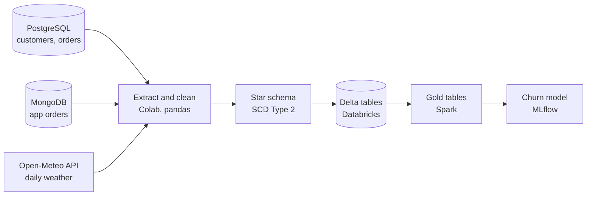
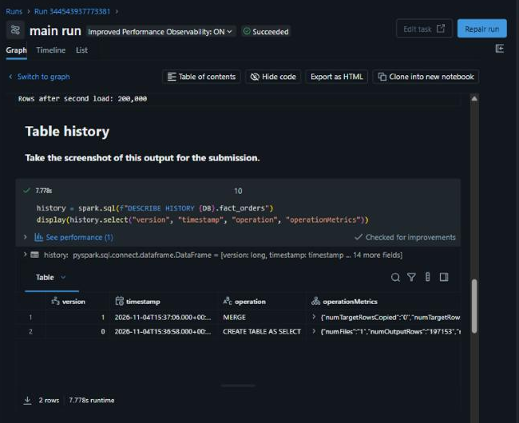

# Online Shop Data Pipeline

An end-to-end ETL pipeline for an online shop in Pakistan: from raw PostgreSQL, MongoDB and API data to a star schema in Delta Lake, Spark business tables and a churn model tracked in MLflow.

**Author:** Mustafa Saeed | **Course:** AI Engineering Bootcamp, Data Warehousing and ETL | **Trainer:** Abdullah Nafees

## Business goals

1. One trusted set of tables that answers "how much did we sell, where, and of what?"
2. A history of where each customer lived, so old reports still show the old city.
3. A first model that flags customers who have stopped buying, so marketing can win them back.

## Pipeline

## Technologies

| Area | Used for | Tools |
|---|---|---|
| **Languages** | Pipeline code and queries | Python, SQL |
| **Sources** | Website orders, app orders, weather | PostgreSQL, MongoDB, Open-Meteo API |
| **Extract and transform** | Chunked reads, flattening, data quality | pandas, SQLAlchemy, PyMongo, Google Colab |
| **Storage** | Star schema with version history | Databricks Free Edition, Delta Lake |
| **Processing** | Business tables (DataFrame API and Spark SQL) | PySpark |
| **Machine learning** | Training, tracking and reloading models | scikit-learn, MLflow |

## Repository and run order

| Order | Notebook | Runs on | Covers |
|---|---|---|---|
| 1 | [`01_colab_extract_transform_design.ipynb`](01_colab_extract_transform_design.ipynb) | Google Colab | Extract, clean, warehouse design |
| 2 | [`02_databricks_load_delta.ipynb`](02_databricks_load_delta.ipynb) | Databricks | Delta tables, MERGE, time travel |
| 3 | [`03_databricks_spark_gold.ipynb`](03_databricks_spark_gold.ipynb) | Databricks | Gold tables and business answers |
| 4 | [`04_databricks_mlflow_churn.ipynb`](04_databricks_mlflow_churn.ipynb) | Databricks | Churn model and MLflow |

The main Spark SQL queries from Notebooks 2 and 3 are also collected in [`sql/queries.sql`](sql/queries.sql).

**To run it:** add `PG_URL` and `MONGO_URL` to Colab Secrets. No connection strings are stored in this repository. If a connection is not available, Notebook 1 uses the backup files in `data/`. Upload the Parquet files from `clean/` to a Databricks volume, then run Notebooks 2 to 4.

**Data source note:** the saved output in Notebook 1 comes from the backup files, which hold the same records as the class databases. Notebooks 2 to 4 ran on Databricks Free Edition (serverless), in the schema `workspace.mustafa_shop`, and their saved output comes from those runs.

## Part 1: Extract

Six raw files: customers (2,000 rows), orders (200,000 rows, read in chunks of 50,000), MongoDB orders (5,000 documents, saved as JSON before flattening), and weather for Lahore, Karachi and Islamabad (662 days each). The incremental function returned **8,593 orders** with `last_run = "2026-10-01"`.

## Part 2: Duplicates and data quality

**Duplicate rule:** an order_id in both sources is one order, so I keep one row: the copy with the latest `updated_at`, or the app copy if they tie. All 5,000 app orders are also in PostgreSQL with identical values. If the web copy won, `source` would say `web` for every order and the app share in Part 5 would be zero. The result is 200,000 orders: 195,000 web and 5,000 app.

| Quality check | Failed rows | Result |
|---|---:|---|
| order_id is never null | 0 | PASS |
| order_id is unique | 0 | PASS |
| customer_id is never null | 0 | PASS |
| amount is greater than zero | 0 | PASS |
| quantity is at least 1 | 0 | PASS |
| every customer_id exists in customers | 0 | PASS |
| no order dated in the future | 0 | PASS |
| status is one of the five known values | 0 | PASS |
| category is one of the six known values | 0 | PASS |
| updated_at is not before order_date | 0 | PASS |

## Part 3: Warehouse design

`dim_date` has 730 days. `dim_customer` is SCD Type 2 with 2,057 rows for 2,000 customers, because I found 57 customers who moved.

- **Example:** customer 469 has a Rawalpindi row valid until 2026-09-19 and a current Multan row from 2026-09-20. Their order from 2026-02-20 joins to the Rawalpindi row, because that date falls inside its valid dates, so old reports still show the old city.
- **Test:** all 3,485 app orders that show a city match the city that `dim_customer` gives for that date.
- **Limit:** the seed script says about 5% of customers moved (about 100), but I can only see a move if an app order shows the old city, because web orders have no city. Most move dates are estimates: only 15 of the 57 movers have a later app order in the new city.

## Part 4: Delta tables

Version 0 of `fact_orders` holds 197,153 orders. The second load merged 2,847 orders updated after 2026-10-20, so the current version has 200,000 rows and no duplicate order_ids. I used MERGE and not append, so a changed order updates its row and does not add a second one.

## Part 5: Answers from the gold tables

Revenue leaves out cancelled and returned orders. I added a fourth table, `gold_city_weather_daily`, because the other three have no daily weather.

| Question | Answer | Evidence |
|---|---|---|
| Which city grew fastest in 2026? | **Lahore** | January to September revenue up 7.15% on the same months of 2025, ahead of Karachi at 5.95%. The same nine months are compared because the data stops on 24 October 2026. |
| Do the three cities get fewer orders on rainy days? | **No** | Orders per day, rainy and dry: Lahore 64.89 and 64.63, Karachi 77.29 and 76.01, Islamabad 33.87 and 33.57. |
| Which category has the highest average order value? | **Electronics** | 78,494, more than double Home at 35,105. |

## Part 6: Churn model

Features use only orders before 2026-08-01, and a check in the notebook confirms it. I did not use `status` as a feature, because it can change after the cutoff.

**Problem with the label:** only **2 of 2,000 customers** placed no order between the cutoff and 2026-10-24, so the brief's label has almost nothing to learn from. I kept that label and logged three runs on it. I also added my own wider label, `went_quiet` (at most 2 orders in the window, 83 customers), so the team gets something usable. Metrics come from cross-validation, because a normal split left no churned customers in the test set.

| Label | Model | Accuracy | Recall | Precision | ROC AUC | Flagged |
|---|---|---:|---:|---:|---:|---:|
| churned | logistic regression | 0.961 | 0.000 | 0.000 | 0.224 | 77 |
| churned | random forest, depth 4 | 0.999 | 0.000 | 0.000 | 0.464 | 0 |
| churned | random forest, depth 8 | 0.999 | 0.000 | 0.000 | 0.471 | 0 |
| went_quiet | **logistic regression (chosen)** | 0.662 | **0.819** | 0.093 | 0.804 | 729 |
| went_quiet | random forest, depth 4 | 0.707 | 0.711 | 0.095 | 0.791 | 621 |
| went_quiet | random forest, depth 8 | 0.836 | 0.434 | 0.114 | 0.774 | 317 |

**My choice:** logistic regression on `went_quiet`. Recall matters most to marketing, because a missed customer is lost while a wrong flag only costs one voucher or message, and this model has the best recall (68 of 83) and ROC AUC. Its precision is low, so marketing should start with the highest scores. No model works on the brief's label, and I would raise that with the trainer. The chosen model (run ID `4e63c9e7c82d4024ada9f25d1f1f158b`, features table Delta version 0) is reloaded by run ID at the end of Notebook 4 and scores five customers.

